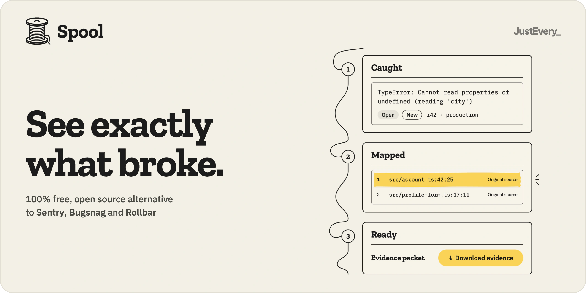
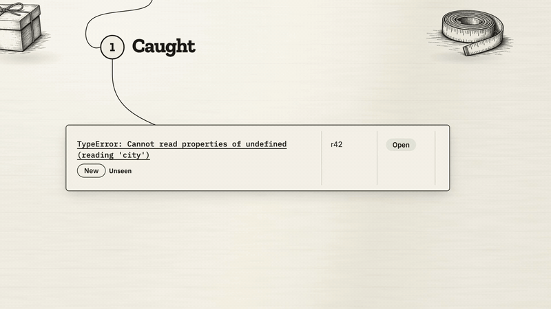
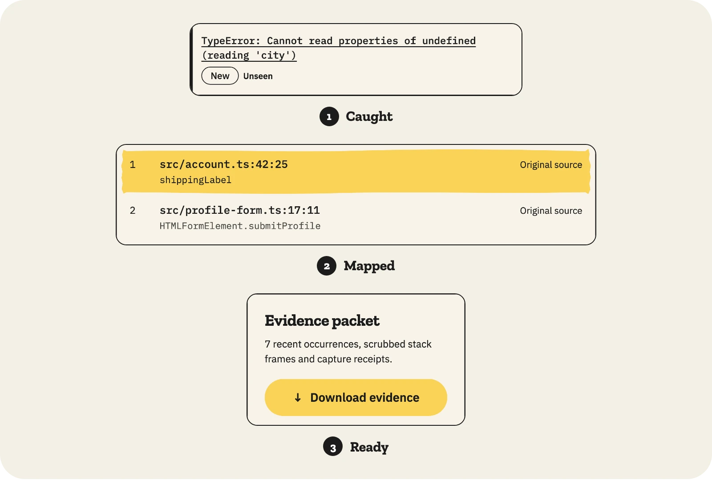
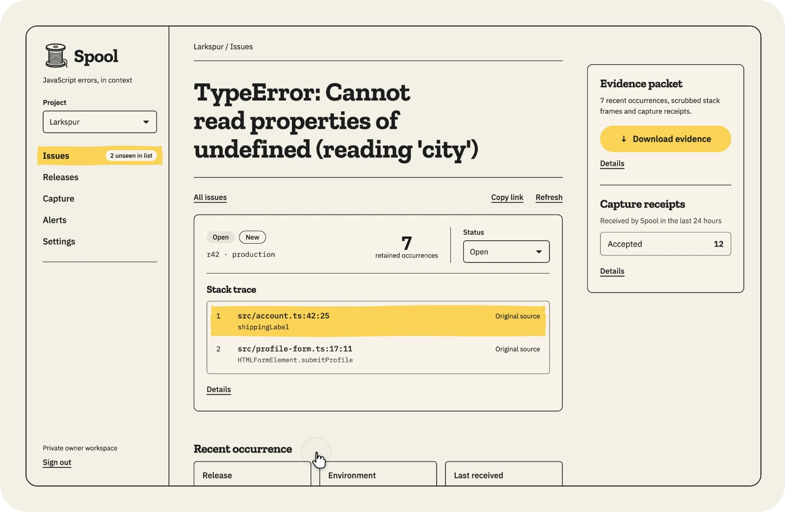
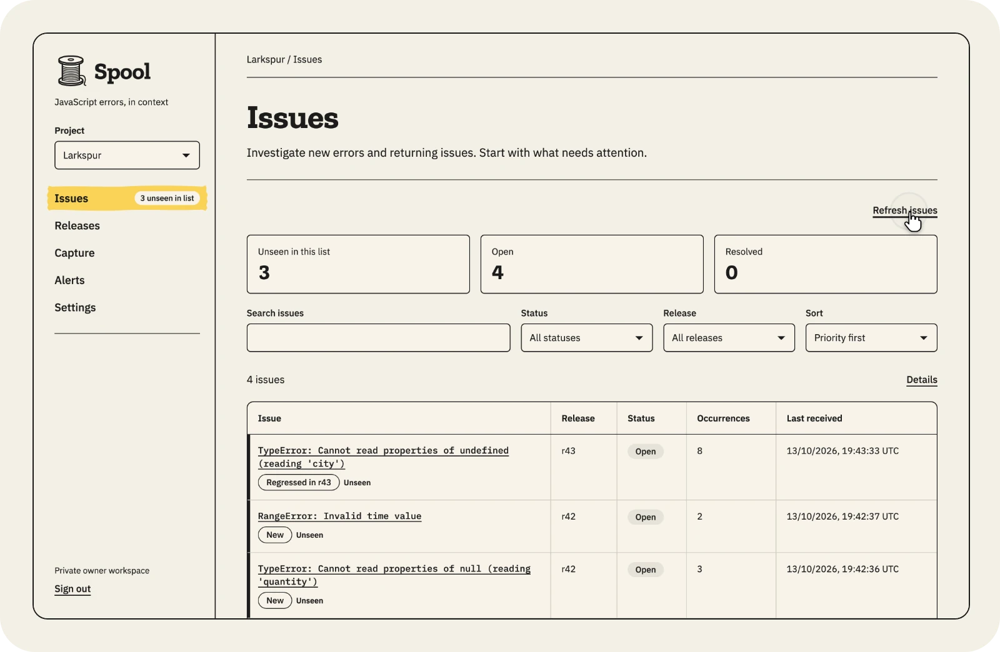

<p align="center">
  <a href="https://run-spool.com">
    <picture>
      <source media="(prefers-color-scheme: dark)" srcset=".github/assets/banner-dark.webp">
      <source media="(prefers-color-scheme: light)" srcset=".github/assets/banner-light.webp">
      
    </picture>
  </a>
</p>

<p align="center"><a href="https://run-spool.com">run-spool.com</a> · <a href="https://justevery.com">Part of Just Every</a> · <a href="LICENSE">MIT licensed</a></p>

<p align="center">
  <a href="https://justevery.com/#vol-spool"></a>
</p>
<p align="center"><a href="https://justevery.com/#vol-spool"><b>Watch the full demo</b></a> · 51 seconds</p>

<p align="center">
  
</p>

<p align="center">
  <br>
  <sub>Each error traced to the exact line in your original source.</sub>
</p>

<p align="center">
  <br>
  <sub>A fixed error that comes back is flagged as a regression in its release.</sub>
</p>

# Spool · See exactly what broke

Spool catches JavaScript, Python and Go errors, groups repeats into issues, and maps JavaScript stacks back to your original source. Download an evidence packet for a fix, give an agent evidence access and inert grouping-proposal submission to one project, and see when a resolved error comes back in a later release. One owner can keep several projects separate, export private evidence and restore it into a fresh copy.

Public source: [just-every/run-spool](https://github.com/just-every/run-spool). Published versions are listed in [GitHub Releases](https://github.com/just-every/run-spool/releases). See the [changelog](CHANGELOG.md). Licensed under the [MIT License](LICENSE).

Run Spool on your computer without a Cloudflare account or mail provider, or deploy it to your own Cloudflare Worker and D1 database. The [first-release jobs and verification requirements](ACCEPTANCE.md) describe what to expect.

## Run it on your computer

macOS, Linux or Windows with WSL2. git is required; rer brings Node and pnpm. This one-line install, also on the [Run page](https://run-spool.com/run), finds the newest stable release tag, prints it, checks out the release commit and starts Spool:

```sh
SPOOL_TAG=$(git ls-remote --refs --tags --sort=-version:refname https://github.com/just-every/run-spool.git | awk '$2 ~ /^refs\/tags\/v[0-9]+\.[0-9]+\.[0-9]+$/ && !tag { sub("refs/tags/", "", $2); tag=$2 } END { if (tag) print tag }') && test -n "$SPOOL_TAG" && printf 'Installing Spool %s\n' "$SPOOL_TAG" && mkdir run-spool && git init -q run-spool && git -C run-spool remote add origin https://github.com/just-every/run-spool.git && git -C run-spool fetch --no-tags origin "refs/tags/$SPOOL_TAG:refs/tags/$SPOOL_TAG" && git -C run-spool checkout --quiet --detach "refs/tags/$SPOOL_TAG^{commit}" && (cd run-spool && curl -fsSL https://runeditrun.com/install.sh | sh -s -- dev --host localhost)
```

A first local start can take several minutes while rer installs dependencies and prepares Spool. `rer dev` prints progress every 20 seconds and shows how long it will wait.

The installer puts rer in `~/.local/bin` and leaves your shell profile unchanged. The commands below use its full path and work in a fresh terminal. To also use the shorter `rer` command in this terminal:

```sh
export PATH="$HOME/.local/bin:$PATH"
```

Repeat that PATH line in each new terminal if you want the shorter command. If you see 'command not found', run `~/.local/bin/rer cli path` and paste the line it prints.

To clone a specific release, set `SPOOL_TAG` to the tag shown on the GitHub release you chose, then run:

```sh
test -n "$SPOOL_TAG" && mkdir run-spool && git init -q run-spool && git -C run-spool remote add origin https://github.com/just-every/run-spool.git && git -C run-spool fetch --no-tags origin "refs/tags/$SPOOL_TAG:refs/tags/$SPOOL_TAG" && git -C run-spool checkout --quiet --detach "refs/tags/$SPOOL_TAG^{commit}"
```

From that checkout, use `~/.local/bin/rer dev --host localhost` to start Spool. If you already have Node 22 or later, `npx -y @runeditrun/rer dev --host localhost` also works from the checkout. To restart later, use `cd run-spool && ~/.local/bin/rer dev --host localhost`.

`~/.local/bin/rer dev` installs everything, prepares a local owner and prints a link that opens Spool signed in. First start uses `owner@run-spool.test` for the `run-spool` folder above, without asking for an email, even when input is piped. Another folder name produces `owner@<sanitized-folder-name>.test`; existing setup keeps its owner.

On the setup page, enter what to call this installation, your name and your email. You can change the installation name in **Settings → General**, and your name and email in **Settings → Members**. Hosted email changes require a recent sign-in or email verification.

Setup prepares private settings and the database, claims or preserves the owner, opens the local owner without email and stops its temporary app; run `~/.local/bin/rer dev` afterwards. It creates no sample project and sends no real email. For older state, follow [OPERATIONS.md](OPERATIONS.md#existing-installation-recovery).

`~/.local/bin/rer dev` opens signed in as the owner. Open the private `RER_OPEN` link printed on this computer; its `#rer-dev=` fragment carries this checkout's owner gate. Keep the link and gate private. Use this plain `rer dev` link to enter as the owner. In Spool 0.7.17 only, `rer dev --as owner` ended with "entry exchange not observed" (fixed in 0.7.18; on 0.7.27 it prints a link that opens as the owner); on 0.7.17 run plain `rer dev` and open its `RER_OPEN` link. The header shows the installation name you choose; `~/.local/bin/rer demo` adds sample data in disposable state. Mail is silently suppressed in dev and demo; there is no local outbox viewer. To invite someone locally, open **Settings → Members**, create an invitation and copy its pending invitation link. The invitee opens their own single-use, expiring invitation directly in a separate browser on this computer and presses **Join**. They receive only their membership and project access. Never send them the owner’s RER_OPEN link: it signs in as the owner. Mail-off links are kept only for invitations the installation owner sent; an invitation an administrator sent has no link to copy. After removal, their member session loses access; ask the owner for a new invitation to rejoin.

On `http://localhost`, open **Settings → General → Local passkey** after using the private owner link. Choose **Add passkey**. After signing out, choose **Sign in with a passkey** on the Sign in page. Keep the terminal link available on this computer if you lose access to the passkey.

With rer dev v2 (using the rer version pinned in [package.json](package.json)), an ingest key created in dev works directly from your app against local Spool, and a deploy key works from your local build, without the owner gate. Allow your browser app's exact origin in Capture. Dev agent keys still need the gate for evidence and inert proposals: privately extract the `rer-dev` fragment value as `SPOOL_DEV_KEY` for the local agent CLI, as shown in [the agent guide](docs/WITH-YOUR-AGENT.md#local-agent-access). Never give the gate to a browser app. Every dev-minted key is refused by deployed Spool; create fresh keys there. Private archives exclude all project grants.

A fresh installation opens `/setup`. Name your installation and create the first project, then follow the three steps: save your key, send a test error and give the connection code to your developer. Spool's first check is one test event received: choose **Send test error**, wait for Spool to say it received the test error and open the test issue it links; this proves the key and release, not your app's origin. The setup screen shows the ingest key once and leaves it active and unnamed. Name it or revoke it in **Settings → Project keys → Details** (**Save key name**, **Revoke key**). Choose **Continue to workbench** when you are ready. Replace a lost key in Settings. To restore existing evidence instead, choose **Restore a private archive** before creating a project. Register the app's release/build before sending its errors; the setup test registers the release/build shown on that screen.

Stop dev with `~/.local/bin/rer dev --stop` (or Ctrl+C in the foreground) before deploy, verify, reset or transfer. Your owner, projects and evidence stay on this computer for the next start. If signed-in pages never finish loading while `/health` answers, one stop and start has cured it: run `~/.local/bin/rer dev --stop`, then `~/.local/bin/rer dev --host localhost`. [RUN-LOCALLY.md](RUN-LOCALLY.md) describes preview, idle timeout and server capacity. `~/.local/bin/rer describe` lists supported maintenance commands and flags.

Export before reset and import only into an empty destination. Export includes private maps and browser-origin policy but excludes sign-in sessions, project keys, outbox and temporary state. Run setup if the destination has no owner and create new keys after restoring. Browser restore is available from `/setup` before the first project and Settings thereafter. For CLI import of a browser download, first run `chmod 600 /path/to/spool-private-archive.jsonl`; see [the transfer procedure](OPERATIONS.md#data-movement-and-retention). Reset removes only its displayed local inventory and preserves source, exports and deployment records.

## Upgrade an existing installation

Back up first: export a private archive (Settings → **Download private archive**, or stop dev and run `~/.local/bin/rer export --output exports/spool.rer`). Keep the original checkout, database and private settings.

For a tagged update, choose a version from GitHub Releases, set `SPOOL_TAG` to that tag, then run `git fetch --tags && git checkout "$SPOOL_TAG"` and `~/.local/bin/rer dev --host localhost`. To keep following `main`, run `git pull --ff-only` and then `~/.local/bin/rer dev`. Hosted installations update with `~/.local/bin/rer deploy` from the original deploying checkout, retaining its private settings, generated secrets and deployment receipt; follow [the hosting update procedure](docs/HOSTED.md#update-to-a-newer-spool).

Those commands apply any migrations missing from the installed version. Existing projects, evidence, triage states, grouping rules, inbound filters, alert rules and project keys are preserved. No reset or restore is needed for an upgrade. Older native private archives can also restore into a fresh, empty current installation. See the [release record](RELEASE.json) and [changelog](CHANGELOG.md).

## Managed hosting

Spool uses the rer version pinned in [package.json](package.json) and supports RER Managed mail for sign-in links and email alerts. Managed Configure supplies and hides the mail settings: no mail-provider account or copied API key is needed. Free and Assisted self hosting keep their existing provider choices and sender setup; see [the hosting guide](docs/HOSTED.md#managed-mail).

## Run it on your Cloudflare account

Follow [the hosting guide](docs/HOSTED.md) to configure your account and email sender. Stop local dev with `~/.local/bin/rer dev --stop`, then run `~/.local/bin/rer deploy`. Open `/sign-in` on the printed hosted address and request an email link. If you cannot receive mail, `~/.local/bin/rer signin --env-file .rer/deploy/production.env --environment production` prints a private, one-use owner link using the hosting guide's private settings file, the same Cloudflare credentials and original deploying checkout; it expires within 15 minutes.

To remove it, export anything you need and run `~/.local/bin/rer deploy --remove --yes` from the original deploying checkout, retaining its private deployment record and using the same account credentials. The default environment is `production`; add `--environment <name>` for another environment. Removal deletes the Worker and its database. The hosting guide also covers updates and restoring archives. `~/.local/bin/rer deploy --dry-run` builds and validates the package locally without deploying or contacting Cloudflare. It prints the plan and names the inputs a real deploy still needs. A successful dry run exits 0 even when those inputs are missing; it does not establish that a real deploy is ready.

## Capture protocol

Spool's own SDK, [`@just-every/spool`](packages/sdk/README.md), is the way to send errors. For browser capture without Node.js or npm, download `/errors-capture.js` from your Spool installation, serve it with your app and follow the [browser-helper setup](docs/capture.md#browser-capture-without-nodejs-or-npm). Or install the SDK and initialise it once with the project's endpoint and ingest key:

Run this in **your application’s repository**, with [Node.js and npm](https://nodejs.org/en/download) installed and available on PATH. The Spool installer’s private Node runtime runs Spool itself; it does not put Node or npm on your shell’s PATH for your application.

```sh
npm install @just-every/spool
```

As of 2026-11-12, this installs SDK 0.1.0, the published npm version. SDK 0.2.0 remains owner-held and unpublished. Ordinary error capture and map upload work with 0.1.0; exposure measurement (`client`, `anonymousClient()` and `exposure()`) and the Vite/Rollup upload-count message require 0.2.0. The Spool app release does not publish or upgrade the SDK. See the [SDK release notes](packages/sdk/CHANGELOG.md).

```js
import { init } from '@just-every/spool';
init({ endpoint: 'https://spool.example.com', project: 'web-app', ingestKey: 'YOUR_INGEST_KEY',
  release: 'web@1.4.0', build: 'b1907' });
```

The browser SDK captures errors and unhandled rejections and can attach the last 20 explicit, scrubbed breadcrumbs. Use `@just-every/spool/node` for Node and `@just-every/spool/worker` for Cloudflare Workers. The package also includes `npx spool-sourcemaps` and the Rollup/Vite plugin at `@just-every/spool/vite` for uploading maps that match your build.

Setup, Capture and Settings show the install line and init for your project. Allow your app's browser origin before connecting it; **Send test error** runs inside Spool and does not check that external origin. Follow [the capture guide](docs/capture.md) for browser permissions, local key scopes, release registration and map upload. Pages without a bundler can use `/errors-capture.js`.

### Already using Sentry? Point your DSN here

Each project can issue a Sentry DSN for supported JavaScript, Python and Go exception reports. Spool scrubs the selected error fields and discards unsupported telemetry. [Switching from Sentry](docs/SENTRY-SWITCHING.md) covers supported intake, map tooling and the optional organization-export importer. The importer has been qualified with synthetic fixtures; a real organization export still needs reconciliation. This does not establish feature parity or a completed migration. The importer is reachable only by a script with the owner's session (`scripts/sentry-import.mjs`; no screen uploads a bundle), or by signed Business grants if the owner turns that door on (off by default). Only the installation owner sends an imported roster's invitations (**Settings → Organization → Members → Imported roster and ownership**) and approves imported alert rules (**Settings → Data → Business imports → Create these rules**); the import itself sends no mail and creates no people or rules. A dry run counts `unmapped` records, meaning parts Spool does not carry over (issue-owner recipients, percent-change and high-priority conditions); it does not drop them. All ten rules of a ten-rule dry run were kept as proposals, and approving them created all ten disabled, each "Needs a destination" (Slack, PagerDuty, member, team or issue owners) until the owner binds one. Only a malformed rule, such as one with no id or a name over 100 characters, is rejected, and the dry run lists it.

## Operating limits and privacy

Spool is intended for bounded error evidence. Each project retains at most 10,000 occurrences and admits at most 120 new occurrences per minute; recorded rejections can reduce the remaining admission budget. The issue list and its filters cover the latest 100 groups, and packets include the latest 10 occurrences. Maps are private uploads. The upload service and current checkout CLI accept flat or indexed V3 maps up to 1 MiB each. The published npm SDK 0.1.0 CLI and the prepared-map picker on **Releases** accept only flat V3 maps up to 256 KiB. There is no lifetime map count; all paths respect the optional project artifact-storage byte cap. The larger/indexed CLI support is in the unpublished 0.2.0 source, not npm 0.1.0. Spool never fetches source URLs. Ingest requests are limited to 32 KiB, 30 frames and 20 breadcrumbs.

The SDK and server scrub common emails, tokens and passwords, but free text can contain personal data those patterns do not recognize. Inspect event and packet previews. There is no durable offline queue, automatic retry or guaranteed unload flush; errors lost before reaching Spool are unknown. Firefox and Safari stack parsing is implemented but has not been tested in those browsers. See [supported languages](docs/SUPPORTED-LANGUAGES.md) for exact Python and Go support and symbolication limits.

Private archives include source maps and exclude sign-in sessions and project credentials. Browser restore accepts up to 16 MiB; use the streaming CLI for larger archives. Older native v1 and v2 archives remain supported. Retention and project erasure cannot remove copies you already exported elsewhere. See [data movement and retention](OPERATIONS.md#data-movement-and-retention) and [project erasure](docs/PROJECT-ERASURE.md).

Optional project alerts cover new issues, regressions in later releases and spikes in received events. Add, edit and test email destinations from **Alerts → Rules**, then select one in a rule ([steps](docs/ALERT-WEBHOOKS.md#manage-email-destinations)). Email alerts require a configured provider; signed webhooks require a separately installed service that enforces destination restrictions. A member alert target must be an active member with access to the project: members still invited are refused. A rule's count fires at or above its number (a distinct-users rule fires above it), so Sentry's "more than 10" imports as 11. Provider submission does not prove recipient delivery. Local mail is suppressed. See [alerts](OPERATIONS.md#per-project-alerts) and [webhook setup](docs/ALERT-WEBHOOKS.md).

The [triage guide](docs/triage.md) explains issue links, mapped stacks and first capture. You can record repair checks and the release that shipped a fix; Spool reports recurrence or explains why the available capture and exercise evidence is inconclusive. It does not infer that a fix worked just because no new error arrived.

## Develop and verify

After `~/.local/bin/rer install`, run `npm run test:setup --` once to install this checkout's Chromium browser for verification; repeat after changing the Playwright version. Stop dev, then run `~/.local/bin/rer verify` to build, typecheck and exercise the application, sign-in, capture, maps, triage and restore flows. These commands run locally and never deploy.

[ACCEPTANCE.md](ACCEPTANCE.md) describes the verification requirements and remaining limits. [AGENTS.md](AGENTS.md) and [OPERATIONS.md](OPERATIONS.md) cover source maintenance and recovery. A passing local check does not establish mail delivery, a live provider integration or large-instance economics.
