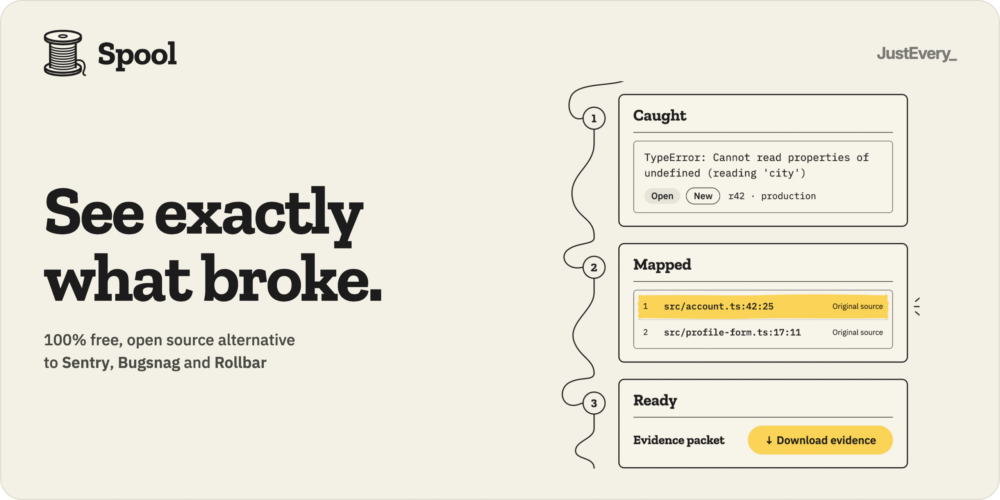
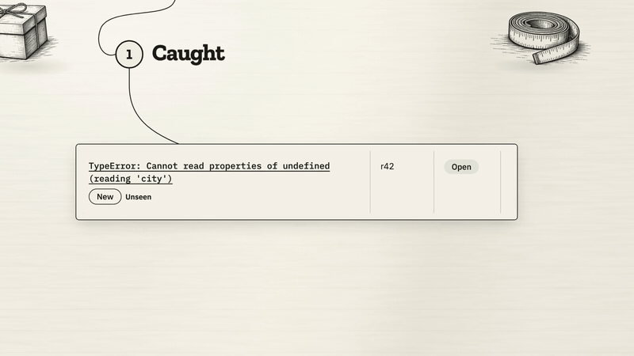
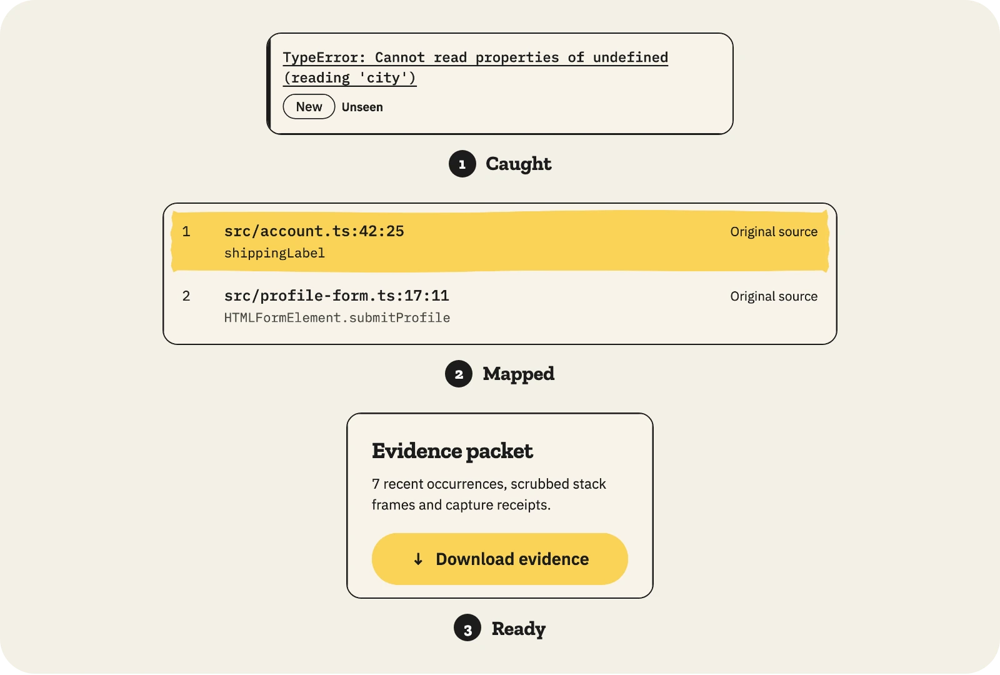
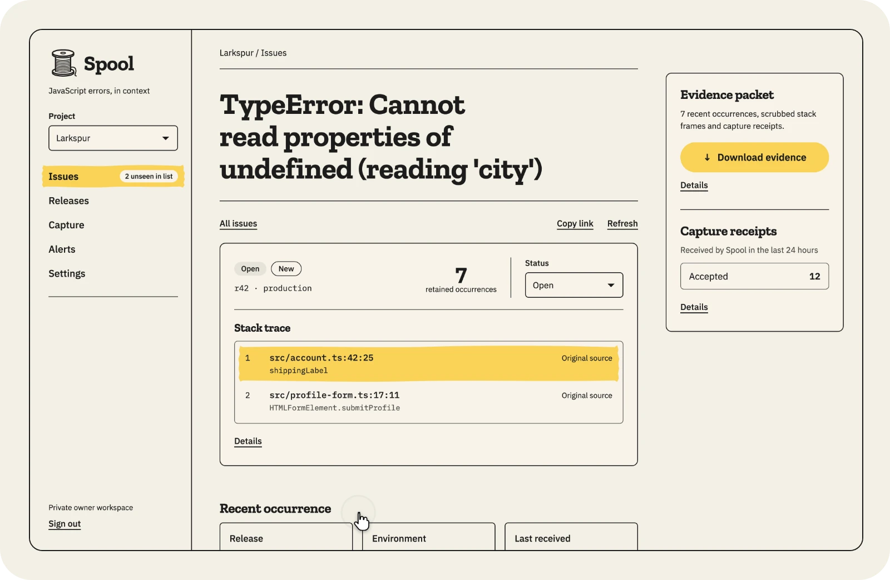
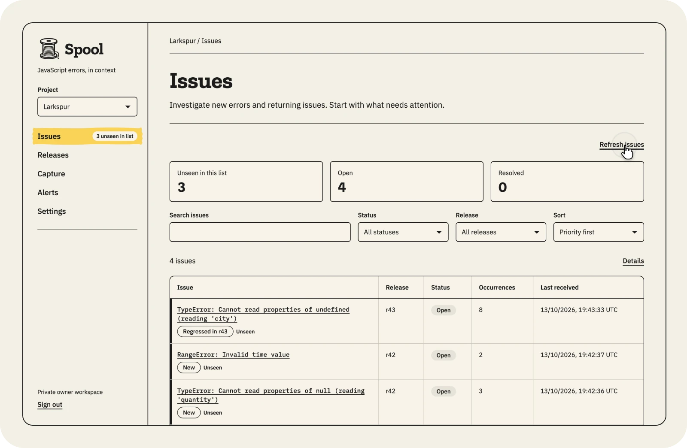

<p align="center">
  <a href="https://run-spool.com">
    <picture>
      <source media="(prefers-color-scheme: dark)" srcset=".github/assets/banner-dark.webp">
      <source media="(prefers-color-scheme: light)" srcset=".github/assets/banner-light.webp">
      
    </picture>
  </a>
</p>

<p align="center"><a href="https://run-spool.com">run-spool.com</a> · <a href="https://justevery.com">Part of Just Every</a> · <a href="LICENSE">MIT licensed</a></p>

<p align="center">
  <a href="https://justevery.com/#vol-spool"></a>
</p>
<p align="center"><a href="https://justevery.com/#vol-spool"><b>Watch the full demo</b></a> · 51 seconds</p>

<p align="center">
  
</p>

<p align="center">
  <br>
  <sub>Each error traced to the exact line in your original source.</sub>
</p>

<p align="center">
  <br>
  <sub>A fixed error that comes back is flagged as a regression in its release.</sub>
</p>

# Spool · Exception evidence workbench

Spool is a local-first, single-owner workbench for bounded JavaScript, Python and Go exception evidence across project-scoped applications. It stores sanitized events in D1 and supports issue grouping, release/build identity, source-map lookup, triage, scoped read-only evidence grants, private archive/restore, and explicit retention.

Public source: [just-every/run-spool](https://github.com/just-every/run-spool), release 0.1.0. Licensed under the [MIT License](LICENSE).

Spool runs locally on a Cloudflare Worker and D1 through Wrangler. Operator-auth owns sign-in; project ingest and agent keys keep their separate scopes. The owner-account deploy command packages this same application. Live deployment, mail delivery and provider acceptance remain unperformed. Do not regenerate the authoritative application from retained Base source.

## Run it on your computer

Clone the source with `git clone https://github.com/just-every/run-spool.git spool` and `cd spool`. Start with **Node 22 or later** and **git**, and install public rer with `npm install -g @runeditrun/rer@0.2.5`. rer supplies the declared Node 22.20.0 and pnpm 10.12.4 runtimes. The public command order is:

With rer 0.2.5, `rer install` bootstraps the pinned pnpm itself. You do not need to install pnpm or add it to PATH.

```sh
rer install
rer setup
rer dev
rer outbox
rer verify
rer reset --yes
rer export --target local --output exports/spool.jsonl
rer import --target local --input exports/spool.jsonl --yes
rer deploy --dry-run
rer describe
```

Use this order with care on a populated installation: export before reset to preserve evidence, and import only into an empty destination. Setup asks for the real owner's email or reads declared setup answers; keep it and secrets out of shell arguments. Setup generates private managed secrets, applies additive local migrations, claims or preserves the one owner, requests ordinary sign-in and stops its temporary app. It creates no sample project and sends no email. For older state, follow [OPERATIONS.md](OPERATIONS.md#existing-installation-recovery).

Dev stays in the foreground and prints the health-ready application URL. `rer dev` opens signed in: it prints `RER_SIGNED_IN` (the owner) and `RER_OPEN`, a link that carries this checkout's private dev key in its fragment. Open `RER_OPEN` in a browser on this computer and you land signed in as the owner; a small dev badge switches to the `member` persona (a signed-in operator who is not the owner) or signs out. Never share the link: the key is what keeps the outbox and dev sign-in closed to anything that reaches this port through a proxy or tunnel, and `reset` removes the key so every earlier browser session stops working. `--as member` (or `--as signed-out`) starts as another persona, and `--login` turns dev identity off so dev prints `RER_SIGN_IN` and a key-carrying `RER_OPEN` for the outbox instead: choose the newest message and follow its one-use link (no email is sent). Previews open the outbox the same way. `RER_OPEN` is for people at this terminal; scripts use `rer dev --json` or the key header. The sign-in form works before JavaScript loads. Keys minted in a dev session are dev-minted and refused without the dev key; use `dev --login` to mint keys for a client outside this checkout. After confirmation, a fresh installation opens `/setup`; create the first project, copy its once-shown ingest key, add the Spool SDK with the shown install line and init, use **Send test error**, and explicitly continue to the workbench. The key stays only in page memory; replace a lost key in Settings. Register the release/build before capture.

Stop dev with its matching `--stop` command before verify, reset or transfer. Preview serves fixed production output; dev supports HMR. Both preserve the same owner and D1 state, and requested ports override runtime origins without rewriting saved settings. [RUN-LOCALLY.md](RUN-LOCALLY.md) describes idle timeout, capacity and the shared job queue. `describe` lists supported verbs and flags.

Export includes private maps and browser-origin policy but excludes owner/auth state, grants, outbox and transient state. Import requires an empty domain database and creates no owner or grants; run setup and create new keys after restoring. Existing or restored projects complete first run, including after restart. Reset removes only its displayed local inventory and preserves source, exports and deployment receipts. Deploy and release dry runs are local checks. Actual accounts, mail sender configuration, deployment, installs, receipts, tags and publication remain owner actions.

## Run it on your Cloudflare account

[docs/HOSTED.md](docs/HOSTED.md) deploys this checkout to your own Cloudflare account with `rer deploy`, which claims the hosted owner and retires the deployed one-time setup token, and updates it to newer source later (export, `git pull --ff-only`, `rer install`, `rer deploy` to the same environment, `node scripts/hosted.mjs check`).

## Capture protocol

Spool's own SDK, [`@just-every/spool`](packages/sdk/README.md), is the way to send errors. Install it and initialise it once with the project's endpoint and ingest key:

```sh
npm install @just-every/spool
```

```js
import { init } from '@just-every/spool';
init({ endpoint: 'https://spool.example.com', project: 'web-app', ingestKey: 'YOUR_INGEST_KEY',
  release: 'web@1.4.0', build: 'b1907' });
```

The browser entry (about 5 KB gzipped, no runtime dependencies) subscribes to Error and UnhandledRejection events and sends explicit, scrubbed breadcrumbs (`breadcrumb(category, message)`, the last 20); `captureException` returns the admission outcome. No SDK function throws or rejects: wrong options, odd thrown values and missing browser APIs settle as a `rejected` outcome with a reason. `@just-every/spool/node` reports uncaught exceptions and unhandled rejections, then prints the app's own error and exits as Node would. `@just-every/spool/worker` sends from a Cloudflare Worker and passes the capture to `ctx.waitUntil`. Release and build are typed, required options, checked at `init`. The same package ships the source-map CLI (`npx spool-sourcemaps`) and the Rollup/Vite plugin (`@just-every/spool/vite`); the debug IDs they inject are read at capture, so `init` needs no debug option. First-run setup, the Capture page and Settings show the install line and this init with the installation's own endpoint, and first-run setup and Settings show the step that allows the app's browser origin next to it. First-run setup has a **Send test error** check; it is sent from Spool's own page, so it checks the key and release, not the app's origin.

The package builds reproducibly from `packages/sdk` (`pnpm sdk:pack` writes the tarball) and bundles the capture core in `src/domain/capture.ts`, which also serves the compatibility file `/errors-capture.js` (`installBrowserCapture`) for pages without a bundler. [The release workflow](.github/workflows/sdk-release.yml) publishes it from an `sdk-v<version>` tag on a main commit with green Verify; every other run is a dry run. There is no guaranteed unload flush, durable offline queue, or automatic retry; retry using the returned `eventId`. Loss before server admission is unknown. Supported stack grammars are V8 (`at function (file:line:column)`) and Firefox/Safari (`function@file:line:column`); columns convert from the stack's 1-based display to 0-based map coordinates.

Exact project browser-origin configuration, ingest-only CORS and credential-omitting transport govern browser capture. Verification uses a real minified application on a second loopback origin; hosted-origin acceptance requires a separate owner journey. See [BROWSER-ORIGINS.md](BROWSER-ORIGINS.md). Server-to-server HTTP uses the scoped key. Custom JSON version 1 fields are `eventId`, `release`, `build`, `environment`, `type`, `message`, `frames`, and `breadcrumbs`. The API requires a Bearer ingest key and limits requests to 32 KiB, 30 frames, and 20 breadcrumbs. Server and client scrub common sensitive patterns before storage and transport. Free text can contain personal data those patterns do not recognize, so inspect event and packet previews. Source maps are confidential owner uploads (flat V3, 256 KiB each, 20 per project); Spool does not fetch source URLs. D1 map storage is a bounded first-release choice, not a high-volume architecture claim.

### Already using Sentry? Point your DSN here

Spool also implements project-scoped Sentry DSNs for supported JavaScript, Python and Go exception envelope and legacy store intake. Selected exception fields and breadcrumb labels pass the native scrubber; unsupported telemetry items are counted and discarded. The source includes verification programs using unmodified `@sentry/browser` and `@sentry/node` 11.6.0; executed results are recorded separately, and package pins alone do not prove runtime acceptance. The source-map CLI and Rollup/Vite plugin register releases and upload bounded flat maps using a project deploy key that grants only those two writes. The owner-only Base import-kit adapter offers reviewed dry run, apply/resume and guarded undo for a bounded organization export bundle; qualification is synthetic-fixture-only until a real owner export is reconciled. See [SENTRY-SWITCHING.md](docs/SENTRY-SWITCHING.md) for exact supported intake, artifact tooling, import format and rollback boundaries. The homepage says Spool is a 100% free, open source alternative to Sentry, Bugsnag and Rollbar, naming them only as what it replaces (owner decision, 12 Oct 2026); no feature-parity or completed-migration claim is made.


## Operating limits and privacy

The implementation caps new-event admission at 120 accepted occurrences per minute per project and retains at most 10,000 occurrences per project. Duplicate/conflicting retries, unauthorized requests, and invalid/oversized bodies return before the admission-budget check. Recorded invalid, oversized, release, and capacity rejections can reduce the budget available for new events; this is not a cap on all ingest attempts. Group queries return the latest 100; evidence packets include the latest 10. Search and triage filters cover only the loaded 100 groups, and the UI states when that limit is reached. Selection opens evidence for that exact project and issue. Historical zero-count groups remain visible after retention. Admission is an atomic D1 transaction, not queue submission. Capture counters cover server admission observations only; without an exposure denominator, verification stays inconclusive. On an issue, the owner can record a repair (a branch or pull request link Spool never fetches, checks, approval, merge, the registered release it shipped in and that the affected flow was exercised); Spool then computes `recurred`, `inconclusive` with its reasons, or `no_recurrence_after_exercise` from captured events and loss counters, never a fixed claim. New-release regression uses the registered release sequence; delayed older releases do not reopen a newer resolved group.

New archives use Base portability JSONL with per-part and whole-content integrity, staged semantic validation and one atomic D1 commit. Legacy native v1 and v2 archives still restore through their strict decoder into that same engine. The browser upload accepts up to 16 MiB; use the streaming local CLI for larger Base archives. Legacy archives retain their 16 MiB and 10,000 rows-per-table bounds. Private maps are included. Owner/auth records, grants, mail outbox, transient origin guards and local settings are excluded. Retention invalidates stored transfer snapshots and records event/map erasures in the same deletion transaction. Copies already exported to another file remain the owner's custody; an old legacy archive cannot know later erasures.

Per-project Alerts implements new-issue, later-release regression and complete server-received volume-window spike feed facts, rules and delivery logs. New-issue and regression alerts are sent right after ingest; the scheduled Worker evaluates spikes and dispatches eligible persisted retries and anything still queued, and records each run's time for `/health` and Settings. Base Mail needs provider acceptance; HMAC-signed webhooks require a separately installed enforcing egress service with no ordinary-fetch fallback. Local capture or provider submission does not prove recipient delivery. No Oncall dependency or Slack integration is required. See [OPERATIONS.md](OPERATIONS.md#per-project-alerts) and the [alert delivery contract](docs/ALERT-WEBHOOKS.md).

`rer verify` builds and typechecks the real application, then runs native Worker/D1 runtime, product/auth/restore, origin and public-command journeys. First run is exercised at 1440 and 390 with no-JavaScript sign-in, actual project forms, failed creation, once-shown keys, Axe/reflow and completed restart. The same verify includes alerts outbox/HMAC/rules/delivery, second-origin mapped capture and regression triage, unmodified Sentry browser/node 11.6.0 programs that change only the DSN, fixture importer dry run/apply/guarded undo and grant-scope checks, and signed first/second claim plus owner editor at 1440 and 390 with CSP and logout revocation. [ACCEPTANCE.md](ACCEPTANCE.md) defines required evidence. The owner's completion report records exact heads and actual results; the presence of a program does not establish a passing run.

After `rer install`, run `npm run test:setup --` once before local verification or browser journeys. This provisions Chromium through this checkout's pinned Playwright CLI; rerun it after changing the Playwright pin. CI provisions the same browser before Verify. Chromium is Playwright's bundled browser by default. Local setup and verification never deploy. `rer deploy --dry-run` validates the real package without provider calls and does not prove deployment or mailbox delivery.

Compatibility programs exercise the capture helper with a minified Node V8 error, an automatic Chromium browser error and a separate emitted Cloudflare Worker using `waitUntil`. `pnpm test:sdk` installs the packed `@just-every/spool` tarball into a fresh app, builds it with the package's Vite plugin, and checks a Chromium capture mapped to the original line with scrubbed breadcrumbs and a Node uncaught exception reported before exit. Firefox and Safari parsing grammar is implemented but has not been tested in a real Firefox or Safari browser. There is no generic framework or SDK compatibility claim. Large-instance economics and hosted recovery remain unaccepted. Automatic sampling is not implemented; transport omissions are unknown.

`pnpm test:ui` starts isolated native Worker/D1 installations and a minified application on a second loopback origin. It signs in through the development outbox, registers releases, captures real browser exceptions, uploads the matching map, and checks the original coordinates, issue links, resolved-to-regressed transition, keyboard details, Axe and responsive bounds at 1440 and 390. Results and masked screenshots are ignored artifacts. The helper bundle is served at the compatibility path `/errors-capture.js`. Execution evidence is recorded separately; the journey being present does not establish a passing run.

Source custody: `edition.json` selects this edition's domain, UI, assets, commands, and retained Base dispatch origin. `node scripts/edition-authoring/cli.mjs check` verifies effective bytes and tool identity against `sources.lock.json`; `.edition/sources` retains comparison bytes. This proves source integrity, not deployment or product acceptance. Issue headlines truncate independently of the full normalized occurrence message.

Text bounds: normalized fields and headlines are at most 1,000 well-formed UTF-16 units, including after redaction. Headlines derive separately from occurrence messages. Retention removes previous derived titles and uses surviving sanitized evidence; concurrent changes may leave an unavailable headline while retained events remain inspectable.

`pnpm test:origins` runs isolated real HTTP/D1 origin, migration, concurrency, redirect, and archive checks without a browser. `pnpm run test:domain` explicitly omits browser journeys; it is not a replacement for full `pnpm verify`.

The [triage guide](docs/triage.md) explains issue links, unseen priority, mapped stacks and first capture.

See [supported languages](docs/SUPPORTED-LANGUAGES.md) for the exact native/Sentry Python and Go grammars, limits, repository path mapping, privacy and unavailable symbolication.
